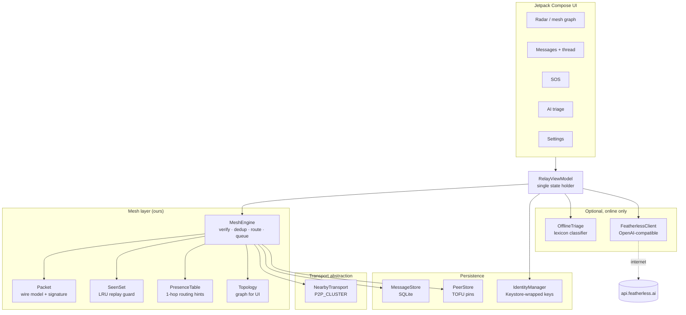

# Relay — offline emergency mesh messenger

**Team FLUX · CBIT Hackathon**

Relay is an Android app that keeps people talking when the network is gone. Phones find
each other over Bluetooth LE, Bluetooth Classic and Wi-Fi Direct, form a mesh, and relay
signed, encrypted messages hop by hop. SOS broadcasts reach every node in range, delivery
is tracked per hop, and everything survives a dead battery, a reboot, or a long radio
blackout.

No accounts. No servers. No internet required for any core feature.

---

## The problem

> During emergencies such as natural disasters, power outages or network failures,
> conventional communication systems may become unavailable … develop a network-independent
> messaging system … relay messages through intermediate devices … prioritize emergency
> messages, display delivery status, broadcast SOS alerts, minimize battery consumption and
> protect messages from unauthorized access.

Relay answers all nine requirements, and treats the offline path as the product rather than
a degraded mode.

| # | Requirement | How Relay implements it |
|---|---|---|
| 1 | **Offline communication** | Everything runs on-device. `INTERNET` is used only by the optional AI assistant. Core messaging has zero network calls. |
| 2 | **Peer-to-peer messaging** | Google Nearby Connections `P2P_CLUSTER` (BLE + Bluetooth Classic + Wi-Fi Direct underneath) with simultaneous links per device. |
| 3 | **Mesh relaying** | Our own store-and-forward router: signed packets, hop budget, per-node de-duplication, presence-gossip routing with flood fallback. |
| 4 | **SOS broadcasting** | Hold-to-send SOS with optional coarse location. Signed, flooded to every reachable node with a 12-hop budget and top queue priority. |
| 5 | **Message prioritization** | Strict priority queue: SOS → urgent → normal. SOS preempts queued chat. On-device triage also ranks incoming traffic. |
| 6 | **Delivery status** | `PENDING → SENT → RELAYED → DELIVERED`, driven by ACKs and relay receipts routed back through the mesh. Shows hop count and the hop trail. |
| 7 | **Security** | ECDSA P-256 signatures on every packet; ECDH P-256 + HKDF-SHA256 + AES-256-GCM for 1:1 bodies; Keystore-wrapped private keys; trust-on-first-use pinning; safety-code verification and blocking. |
| 8 | **Battery efficiency** | Continuous while foreground; short discovery bursts in low-power mode; automatic low-power under 15%; beacons every 60 s instead of 15 s; foreground service keeps relaying with the screen off. |
| 9 | **Recovery & synchronization** | Every undelivered message is persisted with its exact signed wire bytes and re-queued on boot, app restart, or the next peer sighting. |
| + | **Optional AI assistant** | Featherless.ai summaries, urgency classification and translation when online; a transparent on-device classifier keeps prioritisation working when it is not. |

---

## Screens

| | |
|---|---|
| **Radar** — live mesh graph, node/hop/queue counters, in-range peers, SOS entry point | **Messages** — threads with per-message delivery state and hop trail |
| **SOS** — hold-to-send ring, location toggle, broadcast receipt | **AI triage** — urgency-ranked inbox, summaries, translation |
| **Settings** — identity, safety code, low-power mode, peer verify/block, protocol facts | **Onboarding** — key generation happens on-device |

The mesh graph is the centrepiece: this device in the middle, direct neighbours on the
inner ring, nodes advertised by neighbours on the outer ring, with pulses travelling along
links in the direction packets flow.

---

## Architecture



**Layers, deliberately separated**

- `transport/` knows radios and nothing about routing.
- `mesh/` knows the protocol and nothing about Android (it takes a `CoroutineScope` and a
  clock, which is why the routing core is unit-testable on the JVM).
- `data/` is plain SQLite via `SQLiteOpenHelper` — no annotation processing, so builds stay
  fast and reproducible.
- `ai/` is optional and never on the message path.

### Packet lifecycle

```
author                    relay                      recipient
  │  sign(CHAT, dst, ttl)    │                            │
  ├─────────── send ────────►│ verify signature           │
  │                          │ seen? → drop               │
  │                          │ path.size < ttl? → forward │
  │                          │ send RECEIPT ──────────────┼──► author: RELAYED
  │                          ├────────── forward ────────►│ verify, dedup, open
  │                          │                            │ store + notify
  │◄───────────── ACK (path = relays + recipient) ────────┤
  │ DELIVERED · N hops       │                            │
```

---

## Protocol

A packet is JSON on the wire, signed as a whole:

```json
{
  "v": 1, "id": "uuid", "kind": "CHAT|SOS|ALERT|ACK|RECEIPT|BEACON",
  "src": "FINGERPRINT", "srcName": "Asha", "srcSignKey": "…", "srcAgreeKey": "…",
  "dst": "FINGERPRINT | *", "ts": 1760000000000, "ttl": 8, "prio": 2,
  "enc": true, "body": "base64", "ref": "uuid-of-original",
  "reach": ["…"], "path": ["…"], "sig": "base64"
}
```

- **`ttl` is signed and immutable**; **`path` is the mutable hop trail**. A relay forwards
  only while `path.size < ttl`, and appends its fingerprint — so hop limiting is
  tamper-evident, and the ACK comes back carrying the real route.
- **De-duplication**: every node keeps a 4096-entry LRU of packet ids. A packet is
  forwarded at most once per node, which terminates loops before TTL runs out and blocks
  replays.
- **Routing**: `BEACON` packets gossip "these fingerprints are one hop from me". Unicast is
  handed to neighbours that advertise the destination; with no hint the packet floods.
  Delivery is never worse than flooding — it is usually much cheaper.
- **Priority**: a single `PriorityQueue` orders SOS (0) before alerts (1) before chat (2),
  with pacing between sends so SOS cannot be starved by a chat backlog.
- **Statuses**:
  - `PENDING` — stored, no peer yet.
  - `SENT` — handed to at least one neighbour.
  - `RELAYED` — a receipt came back from an intermediate node.
  - `DELIVERED` — the recipient's ACK came back, with the number of hops it travelled.
- **Store-and-forward**: the exact signed bytes are persisted, so a message can be
  retransmitted verbatim after a reboot — signature included.

---

## Security model

| Concern | Mechanism |
|---|---|
| Authenticity / tamper | ECDSA P-256 / SHA-256 signature over all immutable fields. Relays verify before forwarding. |
| Confidentiality (1:1) | Ephemeral ECDH P-256 → HKDF-SHA256 (packet id as `info`) → AES-256-GCM. Relays forward ciphertext they cannot open. |
| Key storage | Private keys wrapped by an AES-256-GCM key in the Android Keystore (hardware-backed where available). `adb pull` yields ciphertext. |
| Identity | Fingerprint = first 12 base32 chars of SHA-256(signing key). Public keys travel in packets and are pinned on first sight (TOFU). |
| Impersonation | A packet whose key does not hash to its claimed `src` is dropped; a known fingerprint with different keys is rejected, never overwritten. |
| Replay | LRU seen-set + a 2-hour timestamp window. GCM associated data binds the packet id. |
| Basic authentication | Out-of-band safety-code comparison (four 3-digit groups over both public keys); peers can be verified or blocked. |

**Threat model, stated plainly:**

- **SOS broadcasts are signed but not confidential.** The audience is unknown and the
  message must be readable by any helper, including one using a modified client. Anyone in
  range can read an SOS; nobody can forge or alter one.
- **Metadata is visible to relays**: sender, recipient and hop trail. Bodies are not.
- **TOFU has a first-contact window.** Comparing safety codes closes it.
- **Denial of service is out of scope.** A jammer can always win; the mesh degrades to
  store-and-forward rather than failing.

---

## Battery strategy

- **Foreground**: continuous advertise + discover, beacon every 15 s.
- **Low power**: advertising stays on (cheap and keeps you findable); discovery runs in
  8-second bursts every 50 seconds; beacons every 60 s.
- **Automatic**: under 15% battery the app starts in low-power mode.
- **Background**: a `connectedDevice` foreground service keeps the mesh and outbox alive
  with the screen off; the notification shows the live node count.
- **Backoff by design**: no peers → no sends; presence hints mean unicast avoids blind
  flooding; duplicates are dropped before they reach the radio.

---

## Recovery and synchronization

- Undelivered messages live in SQLite with their wire bytes; the outbox is re-queued on
  app start, service start, boot (`BOOT_COMPLETED` receiver) and every peer connection.
- A phone that was off during an alert catches up as soon as it hears a beacon: messages
  are re-flooded with their original signatures and TTL budget.
- The seen-set is per-process, so a restart can re-forward; receivers de-duplicate and
  `INSERT OR REPLACE` keeps the store consistent.

---

## AI assistant (optional, online)

The assistant is deliberately two-tier:

1. **On-device triage (always works)** — `OfflineTriage` scores every message with a
   transparent emergency lexicon (critical / urgent / needs / safe), assigns a category,
   a ≤96-character summary and a script-based language guess. This drives the triage
   ranking with the radio off and no internet.
2. **Featherless.ai (only when online)** — when a key is configured and the network is
   validated, `FeatherlessClient` calls the OpenAI-compatible endpoint
   `POST https://api.featherless.ai/v1/chat/completions` with
   `Qwen/Qwen2.5-7B-Instruct`, requesting strict JSON: summary, urgency 1–5, category,
   translation. The result refines, never replaces, the on-device score, and is stored in
   SQLite.

**Privacy:** messages are uploaded only when you tap *Analyze* (or an incoming SOS/alert is
triaged) while online. Nothing is sent in the background, and the core app never waits for
a response. AI output is labelled *advisory* in the UI; it never replaces emergency
judgment.

### Configure the key

```properties
# local.properties (git-ignored)
FEATHERLESS_API_KEY=your_key_here
```

or `./gradlew -PFEATHERLESS_API_KEY=… assembleDebug`. Without a key the app runs fully
offline and the triage screen says so.

---

## Build and run

**Requirements:** Android Studio 2026.1+ (JBR 25), Android SDK platform 37, minSdk 26.

```bash
git clone <repo-url>
cd relay
# put your SDK path in local.properties:
#   sdk.dir=C\:\\Users\\you\\AppData\\Local\\Android\\Sdk
./gradlew :app:assembleDebug
adb install -r app/build/outputs/apk/debug/app-debug.apk
```

**On this machine** (Gradle must run on the Studio JBR; the system JDK 26 is too new):

```powershell
$env:JAVA_HOME="E:\Android Studio\jbr"
.\gradlew.bat :app:assembleDebug
```

**Run the tests:**

```bash
./gradlew :app:testDebugUnitTest
```

25 JVM tests cover signature coverage, seal/open, AAD binding, tamper rejection, LRU
eviction semantics, and presence routing.

### Demo with three phones

1. Install the APK on all three. Create an identity on each (names: `Asha`, `Bilal`, `Chen`).
2. Grant nearby permissions; leave **Wi-Fi and Bluetooth on**, airplane mode **off** (the
   radios still need to be enabled — there is no internet involved).
3. Place A and C out of direct range, with B between them (or simply start A→B and C→B and
   watch the topology).
4. Open the radar: B appears on A's inner ring; C appears on the outer ring via B's beacon.
5. Send a message A→C. The bubble goes `PENDING → SENT → RELAYED → DELIVERED · 2 hops`,
   with the hop trail `you › B › C`.
6. Hold SOS on A. Every node shows the broadcast; the alert is queued if a phone is out of
   range and delivered when it returns.
7. Kill the app on B, send again, then reopen: the queued message is replayed from SQLite.
8. Optional: connect one phone to the internet, add the Featherless key, and open AI triage.

---

## Project layout

```
app/src/main/java/com/flux/relay/
├── RelayApp.kt              Application + ServiceLocator
├── ServiceLocator.kt        hand-rolled DI (no Hilt)
├── crypto/                  CryptoBox, Identity, IdentityManager
├── data/                    SQLite schema, MessageStore, PeerStore
├── mesh/                    Packet, SeenSet, PresenceTable, Topology,
│                            MeshEngine, RelayService, BootReceiver, BatteryPolicy
├── transport/               Transport interface + NearbyTransport
├── ai/                      OfflineTriage, FeatherlessClient, NetworkMonitor, AiAssistant
└── ui/                      MainActivity, RelayRoot, RelayViewModel, screens, components, theme
```

**Deliberate omissions:** no Room/KSP (build risk), no Hilt (one object graph), no
third-party crypto (platform JCA is enough and audits cleanly). Multi-module was rejected
for build speed during a 24-hour event.

---

## Known limitations

- **iOS is not supported** — Nearby Connections is Android/Play-services only.
- **Dense crowds** can saturate the flooding fallback; presence hints mitigate but a
  proper spray-and-wait or quota scheme would scale better.
- **SOS is public by design** (see threat model).
- **No offline map** — location is attached as coordinates, not rendered.
- **The seen-set is in memory**, so a cold start may re-forward a packet once; receivers
  suppress the duplicate.
- **Background delivery depends on the OEM** allowing the foreground service to survive
  aggressive battery managers.

## Next steps

- Group keys for private circles (SOS to trusted responders only).
- Image/voice payloads chunked across the mesh.
- A routing metric better than hop count (link quality + battery).
- iOS via MultipeerConnectivity behind the same `Transport` interface.

---

## License

MIT — see [LICENSE](LICENSE).

Built during the CBIT Hackathon by **Team FLUX**.
